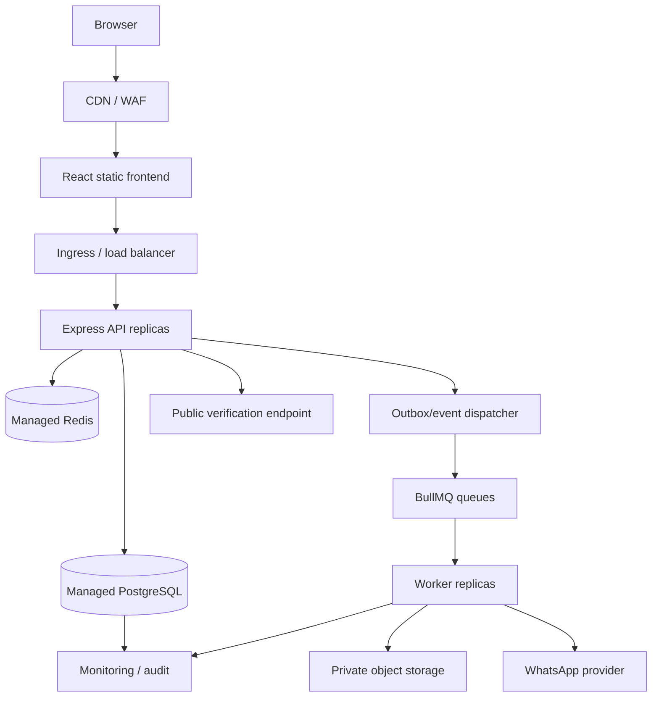

# Production deployment plan (100k users / peak 30k certificate deliveries)

## Architecture

## Hosting
- Frontend: CDN-backed static hosting; WAF and TLS at edge.
- API: managed container platform/Kubernetes with autoscaling replicas.
- PostgreSQL: managed HA PostgreSQL, multi-AZ, connection pooling, backups and PITR.
- Redis: managed Redis with persistence/HA; queue data durability settings selected and tested.
- PDFs: private S3-compatible storage, encryption at rest, short-lived signed URLs.
- Workers: separately deployed containers; autoscale by queue depth and CPU, provider rate limits.
- Observability: OpenTelemetry traces, structured logs, metrics, managed dashboards/alerts.

## Peak and scaling
30,000 PDFs/messages in an hour (~8.3 jobs/s average); target bursts require worker concurrency, provider throttling and backlog monitoring. Scale worker pools horizontally. Queue is the buffer; enforce provider throughput limits and exponential backoff. PDF generation and delivery are separate jobs. API replicas scale statelessly; DB is the likely bottleneck, mitigated with pooling, indexes, batch writes and read replicas for verification. Public verification is cacheable but revocation invalidation must be immediate; short TTL or cache busting.

## Failure handling
- Worker crash: BullMQ retries stalled jobs; idempotency key and DB uniqueness prevent duplicate certificates/delivery records.
- Redis restart: durable queue configuration and Redis persistence; rehydrate/reconcile pending work from transactional outbox.
- WhatsApp outage: retry with exponential backoff, jitter, dead-letter queue after bounded attempts, dashboard and manual replay. Don't block approval.
- Slow DB: timeout/circuit breaker, pool limits, retry only safe transactions, query monitoring and read replicas where appropriate.
- Race conditions: serializable/locking transaction and unique constraints for voting and certificate issuance.

## Access and storage
Private object bucket, encryption, signed URLs with short expiry, tenant/centre scoped access checks, certificate token revocation table/status. Public verification does not return email, phone, score, or other candidate data. Audit log retained according to policy; tamper-evident export/immutable storage in production.

## Monitoring/alerts
Queue age/depth, job retries/failures, provider response/latency, API p95/p99 and error rate, DB connections/locks/slow queries, Redis health, certificate issuance throughput, stuck batches. Alert when batch age crosses SLA, DLQ rises, provider fails, or DB latency/availability degrades.

## Rough monthly cost (indicative, USD; region/provider dependent)
- App/API/worker containers: $150–$450
- Managed PostgreSQL HA: $200–$600
- Redis: $50–$150
- Object storage/egress: $30–$150
- CDN/WAF/monitoring: $50–$250
- WhatsApp: provider conversation/message charges vary widely and are excluded
- **Estimated baseline: $480–$1,600/month plus messaging**, with trade-off: managed services reduce operational risk but cost more; smaller single-node setup is cheaper but not HA.

## Rollout
1. Infrastructure as code and secrets manager.
2. Staging load tests at >10 jobs/s with simulated provider.
3. Canary deployment, schema migrations separately, rollback plan.
4. Backups/PITR tested; disaster recovery runbook and RTO/RPO agreed.
